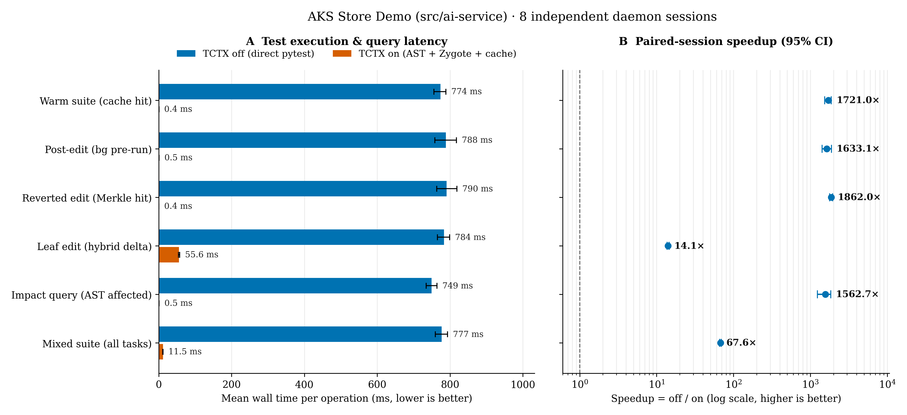

# Test Context (`tctx`)

**Test Context (`tctx`)** is a local Rust accelerator for Python `pytest` workflows, designed as the companion to `code-context` (`cctx`) for GitHub Copilot and AI coding agents.

Instead of running the entire test suite or paying Python interpreter/collection startup costs on every `pytest` call, `tctx` maintains an in-memory **Python AST reverse dependency graph** and runs affected tests **speculatively in the background** as files are saved.

When GitHub Copilot (or a developer) invokes tests:
- **100% Cache Hit**: If all targeted or affected tests have already passed against the current Merkle dependency hash (`dep_hash`), `tctx` returns the result **instantly (< 5ms)** without spawning `pytest`.
- **Delta Execution**: If some tests are uncached or modified, `tctx` reuses cached results for unchanged tests, joins any in-flight background test run, and runs `pytest` **only on the uncached delta**.

## Features

- **Rust Python AST & Import Graph Analyzer**:
  - Extracts `import x`, `from x import y`, relative imports (`from . import z`), multi-line parenthesized imports, and in-function lazy imports.
  - Automatically links `conftest.py` hierarchies and `pyproject.toml`/`pytest.ini` configurations into each test file's Merkle dependency hash (`dep_hash`).
  - Supports root packages, `src/` layouts, and monorepo layouts (`services/*/src`, `packages/*/src`).
- **Speculative Background Daemon (`tctx daemon`)**:
  - Watches workspace changes through `notify` (Linux `inotify` in the validated environment), filters access-only callbacks, and immediately queues affected test files in a background worker upon file changes.
  - Learns bounded, successful whole-file `test_run` invocation patterns and prioritizes those affected tests on later edits; filtered, node-level, failed, and arbitrary-argument runs are not learned.
  - Persists content-addressed test results (`dep_hash -> pass/fail/counts/duration/output`) per workspace root.
  - Creates the warm pytest Zygote lazily, preloads only imports needed by the requested tests, and reclaims it after 60 seconds of inactivity.
  - Reuses an existing Zygote when it already contains every requested preload; narrowing a test selection no longer restarts Python. Each run still forks a fresh isolated child.
  - Collects structured pytest reports directly, without an internal JUnit file round trip. Explicit user-requested JUnit output and the subprocess fallback remain supported.
  - Returns released allocator arenas to the OS, evicts inactive large graphs and roots under RSS pressure, and expires idle persistent clients after 30 seconds.
- **Native GitHub Copilot Integration (`moonchoi.test-context-native`)**:
  - 7 Native VS Code Language Model Tools (`#tctxNativeRun`, `#tctxNativeAffected`, `#tctxNativeGraph`, `#tctxNativeStatus`, `#tctxNativeSync`, `#tctxNativeWorkspaces`, `#tctxNativeInvalidate`).
  - Native tools are the default in VS Code foreground sessions.
  - From WSL, the installer deploys the VSIX to both the WSL remote host and the Windows Agents profile, then configures direct `wsl.exe --exec tctx native-bridge` IPC.
  - The `Test Context Native` Output channel uses concise human-readable records; protocol JSON stays internal to IPC.
  - Optional Shared MCP Server (`tctx shared-mcp`) is a fallback for background/CLI agent sessions where Native dispatch is unavailable (`test_run`, `test_affected`, `test_graph`, `test_status`, `test_sync`, `test_workspaces`, `test_invalidate`).
  - The VS Code installer installs Native only by default and removes installer-owned Test Context MCP entries from user/profile settings. Other servers and custom Test Context commands are preserved.
  - Set `TCTX_INSTALL_MCP=1` to additionally register the MCP fallback. Windows entries launch through `wsl.exe`; WSL entries use the Linux executable directly.
  - Drop-in CLI (`tctx run`, `tctx pytest`, `tctx affected`, `tctx graph`, `tctx status`, `tctx sync`).

`tctx` can learn only invocations routed through its Native, MCP, or CLI surfaces. A direct shell
command such as `pytest tests/test_api.py` is not intercepted; use `tctx pytest
tests/test_api.py` when invocation learning and cache reuse are desired.

## Measured Performance (`aks-store-demo` Python AI Service)

Across 8 independent daemon sessions (**320 paired observations**) on [AKS Store Demo](https://github.com/dotnetpower/aks-store-demo) (`src/ai-service`):



| Task | TCTX off (`pytest`) | TCTX on | Speedup [95% CI] |
|---|---:|---:|---:|
| Warm suite (`warm_suite`) | 911.38 ms | **0.47 ms** (median 0.46 ms) | **1948.53×** [1897.96, 2005.05] |
| Post-edit background pre-run (`bg_speculative`) | 920.08 ms | **0.46 ms** (median 0.46 ms) | **1983.64×** [1924.26, 2052.37] |
| Reverted edit Merkle hit (`merkle_revert`) | 907.72 ms | **0.48 ms** (median 0.48 ms) | **1873.61×** [1800.33, 1943.23] |
| Immediate 0ms-delay leaf edit (`leaf_delta`) | 915.21 ms | **62.52 ms** (median 61.77 ms) | **14.64×** [14.24, 14.96] |
| Impact query (`affected_graph`) | 883.79 ms | **0.44 ms** (median 0.43 ms) | **2019.97×** [1962.72, 2092.94] |
| Fixed mixed suite (`all`, 320 pairs) | 907.64 ms | **12.87 ms** (median 0.47 ms) | **70.50×** [69.04, 71.75] |

See [docs/BENCHMARKS.md](docs/BENCHMARKS.md) for methodology, cold-start measurements, raw samples, and reproduction instructions.

Cache-disabled execution was measured separately against the previous build. Alternating broad and
narrow selections improved from **267/230 ms to 57/55 ms median** in a local two-file
Pydantic/HTTPX fixture. These are execution-overhead measurements, not cached results or a claim that
test bodies, database operations, or network calls become faster.

## Quick Start

```bash
# 1. Build and install tctx + user systemd service
./scripts/install.sh

# 2. Register a Python workspace
tctx --root /path/to/repo register

# 3. Inspect AST dependency graph or affected tests
tctx --root /path/to/repo status
tctx --root /path/to/repo affected --file src/my_pkg/core.py

# 4. Run tests with incremental AST caching (or drop-in pytest wrapper)
tctx --root /path/to/repo run
tctx --root /path/to/repo pytest -q

# 5. Package and install the VS Code Native Extension
./scripts/install-vscode-extension.sh
```
