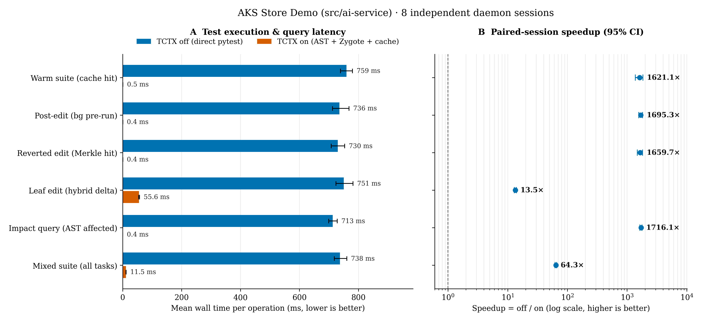
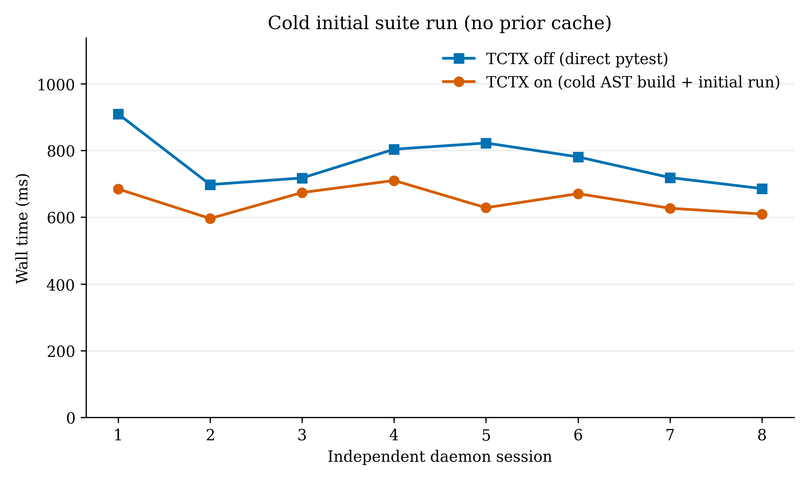

# Pytest Efficacy Benchmark: TCTX Off versus On (`aks-store-demo`)

## Result and Scope

Across **8 independent daemon sessions** (320 paired observations) targeting the Python FastAPI service (`src/ai-service`) of [`aks-store-demo`](https://github.com/dotnetpower/aks-store-demo):

- **Warm suite re-execution (`warm_suite`)**: **759.42 ms without TCTX** vs **0.47 ms with TCTX** (**1,621.08× speedup**, 95% CI **1,370.79–1,848.10×**; median **750.34 ms → 0.41 ms**).
- **Post-edit speculative background run (`bg_speculative`)**: When a router (`src/ai-service/routers/description_generator.py`) is edited and the background worker verifies affected tests while the developer or AI coding agent is reasoning, the subsequent `test_run` call takes **0.43 ms** vs **735.72 ms** for direct `pytest` (**1,695.29× speedup**, 95% CI **1,571.75–1,823.50×**; median **718.47 ms → 0.41 ms**).
- **Reverted edit Merkle cache hit (`merkle_revert`)**: Reverting a source edit back to a previously verified state hits the content-addressed SHA-256 Merkle `dep_hash` history in **0.44 ms** vs **730.23 ms** (**1,659.69× speedup**, 95% CI **1,481.43–1,823.71×**).
- **Immediate 0ms-delay leaf edit (`leaf_delta`)**: Calling `test_run` immediately (0 ms delay) after editing an isolated leaf helper skips 3 cached test files and runs only the 1 affected test file via the **Warm Pytest Fork Zygote (`os.fork()` with safe preloads, explicit plugin manifest, bounded output pipes, process-group cancellation, dynamic data-dependency capture, and source-stability verification)** in **55.62 ms** vs **750.60 ms** (**13.49× speedup**, 95% CI **12.91–14.04×**; median **740.79 ms → 53.72 ms**).
- **Impact analysis (`affected_graph`)**: Querying affected tests via the in-memory Rust AST reverse dependency graph takes **0.42 ms** vs **712.73 ms** for `pytest --collect-only` (**1,716.14× speedup**, 95% CI **1,637.37–1,786.31×**).
- **Fixed mixed suite (`all`, 320 pairs)**: **737.74 ms off → 11.48 ms on** (**64.29× mean speedup**, 95% CI **62.15–66.39×**, and **1,729.37× median speedup** from **728.22 ms to 0.42 ms**).



| Task | Pairs | TCTX off mean | TCTX on mean | Off median | On median | Speedup [95% CI] |
|---|---:|---:|---:|---:|---:|---:|
| Warm suite (`warm_suite`) | 64 | 759.42 ms | 0.47 ms | 750.34 ms | 0.41 ms | 1621.08× [1370.79, 1848.10] |
| Post-edit bg pre-run (`bg_speculative`) | 64 | 735.72 ms | 0.43 ms | 718.47 ms | 0.41 ms | 1695.29× [1571.75, 1823.50] |
| Reverted edit (`merkle_revert`) | 64 | 730.23 ms | 0.44 ms | 721.67 ms | 0.41 ms | 1659.69× [1481.43, 1823.71] |
| Immediate leaf delta (`leaf_delta`) | 64 | 750.60 ms | 55.62 ms | 740.79 ms | 53.72 ms | 13.49× [12.91, 14.04] |
| Impact query (`affected_graph`) | 64 | 712.73 ms | 0.42 ms | 712.84 ms | 0.38 ms | 1716.14× [1637.37, 1786.31] |
| Fixed mixed suite (`all`) | 320 | 737.74 ms | 11.48 ms | 728.22 ms | 0.42 ms | 64.29× [62.15, 66.39] |

## Cold Start Behavior



On a cold cache (first run in a brand-new daemon session with no cached `dep_hash` entries), TCTX performs Python/pytest/plugin environment fingerprinting, builds the AST graph, captures initial runtime data dependencies, and executes all 4 test files. In this run, the full safety setup averaged **649.94 ms** vs **766.96 ms** for direct `pytest` (**1.18× faster**). Cold-start results remain environment-sensitive; the sustained claim is the content-addressed reuse demonstrated by the paired warm and edit scenarios.

## Reproduce

```bash
cargo build --locked --release
uv venv --python 3.12 .venv-benchmark
uv pip install --python .venv-benchmark/bin/python -r benchmarks/requirements.txt
.venv-benchmark/bin/python benchmarks/benchmark.py \
  --root ../aks-store-demo \
  --tctx target/release/tctx \
  --pytest .venv-benchmark/bin/pytest \
  --output /tmp/tctx-benchmark-run \
  --sessions 8 --rounds 8 --seed 20261023
```
