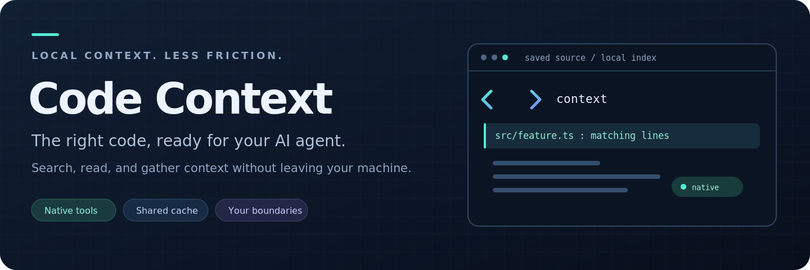
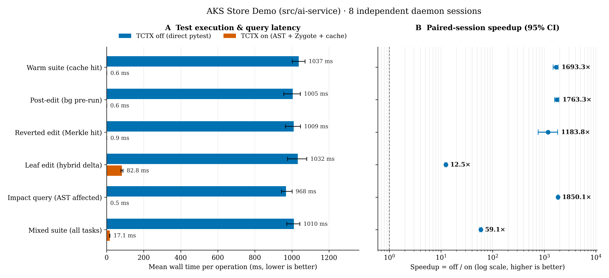

<p align="center">
  
</p>

# Test Context by dotnetpower

**Native VS Code Language Model Tools for Test Context (`tctx`) — incremental Python (`pytest` + `ruff`), Rust (`cargo test`), and Frontend (`React`, `Vite`, `TypeScript`, `CSS/SCSS`, `Vitest`/`Jest`/`Node test`, `ESLint`) AST dependency analysis, speculative background execution, and sub-millisecond cached test results for GitHub Copilot.**
Publisher: **dotnetpower** (`dotnetpower.test-context-native`).

## Resources

[Repository](https://github.com/dotnetpower/test-context) ·
[Benchmark report](https://github.com/dotnetpower/test-context/blob/main/docs/BENCHMARKS.md) ·
[Publishing guide](docs/PUBLISHING.md) ·
[Issues](https://github.com/dotnetpower/test-context/issues) · [License](LICENSE)

## Performance

Across 8 independent daemon sessions (**320 paired observations**) on [AKS Store Demo](https://github.com/dotnetpower/aks-store-demo) (`src/ai-service`):

| Task | TCTX off (`pytest`) | TCTX on | Speedup [95% CI] |
|---|---:|---:|---:|
| Warm suite (`warm_suite`) | 1036.64 ms | **0.61 ms** (median 0.55 ms) | **1693.30×** [1483.04, 1866.03] |
| Post-edit background pre-run (`bg_speculative`) | 1004.61 ms | **0.57 ms** (median 0.53 ms) | **1763.31×** [1594.86, 1934.22] |
| Reverted edit Merkle hit (`merkle_revert`) | 1009.18 ms | **0.85 ms** (median 0.54 ms) | **1183.76×** [764.93, 1824.79] |
| Immediate 0ms-delay leaf edit (`leaf_delta`) | 1031.66 ms | **82.83 ms** (median 76.75 ms) | **12.46×** [11.93, 13.03] |
| Impact query + Ruff pre-check (`affected_graph`) | 968.01 ms | **0.52 ms** (median 0.49 ms) | **1850.15×** [1798.47, 1915.56] |
| Fixed mixed suite (`all`, 320 pairs) | 1010.02 ms | **17.08 ms** (median 0.56 ms) | **59.15×** [56.74, 61.75] |



## Install

```sh
git clone https://github.com/dotnetpower/test-context.git && cd test-context
./scripts/install.sh
code --install-extension dotnetpower.test-context-native
```

For Windows Agents windows backed by WSL, run `./scripts/install-vscode-extension.sh` from WSL to configure the `wsl.exe --exec tctx native-bridge` transport automatically.

## Contributed Language Model Tools

- `#tctxNativeRun` (`test-context-native_testRun`): Run `pytest`, `cargo test`, `vitest`, `jest`, `node --test`, and `go test` incrementally with `< 1ms` instant cache hits for tests already verified against the current semantic Merkle `dep_hash`, plus pre-flight Ruff/ESLint/Clippy diagnostics and optional `ruff_fix: true` auto-remediation. Automatically normalizes absolute target paths and scopes large workspaces (`> 64` tests) to uncommitted `git diff` changes when `targets` is omitted.
- `#tctxNativeAffected` (`test-context-native_testAffected`): Inspect which Python, Rust, Frontend, or Go test files are transitively affected by modified source/stylesheet files or `git diff`, ranked by shortest dependency hop distance with live background cache state, untested modified file alerts, and pre-checked lint diagnostics.
- `#tctxNativeGraph` (`test-context-native_testGraph`): Query direct imports, reverse importers, transitive dependencies, `conftest.py` / `tests/common` / `setupTests.ts` chains, cross-language bridges (PyO3, Wasm, Full-Stack `/api/...` routes, Protobuf), referenced env vars, and semantic Merkle `dep_hash` for any indexed file.
- `#tctxNativeStatus` (`test-context-native_testStatus`): View daemon health, indexed Python/Rust/Frontend file counts, cached test counts, background worker queue, Warm Pytest Zygote status, and cumulative time saved.
- `#tctxNativeSync` (`test-context-native_testSync`): Synchronize the polyglot AST dependency graph with disk and schedule background test execution.
- `#tctxNativeInvalidate` (`test-context-native_testInvalidate`): Invalidate cached test results for specific files or the entire workspace.
- `#tctxNativeWorkspaces` (`test-context-native_testWorkspaces`): List registered `tctx` workspaces.

## Enterprise Scale & Copilot UX Highlights

- **Monorepo Speed (`9,000+` files)**: Parallel multi-core AST indexing loads a 9,042-file / 3,434-test repository in **`~670ms`**, and `u32` integer adjacency + parent-pointer BFS resolves reverse test impact in **`~5ms`**.
- **Semantic AST Hashing**: Comment-only and blank-line formatting edits preserve `semantic_sha256` without invalidating cached test passes, while directive comments (`noqa`, `type:`, `eslint`, `@ts-`, `go:embed`, Rust doctest fences) are preserved.
- **Zero-Config WSL & Multi-Root Resolution**: Automatically resolves workspace roots from target file hints, `vscode-remote://` URIs, and Windows WSL UNC paths (`\\wsl.localhost\...`), with transparent Unix socket auto-reconnect inside `tctx native-bridge`.
- **Context Token Compaction (92.7% Reduction)**: Compacts passing test boilerplate and bounds large dependency lists so Copilot responses stay inline (`< 8 KB`) without `/tmp` file offloading.
